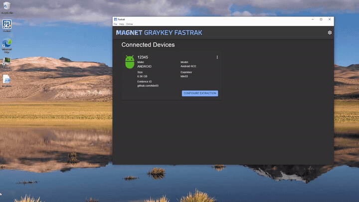
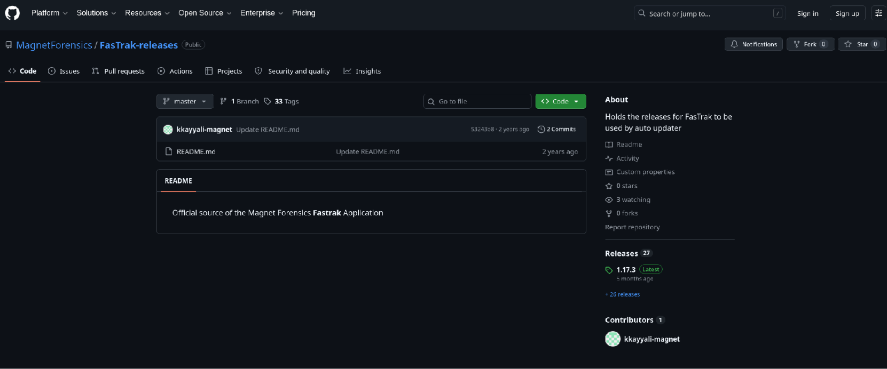
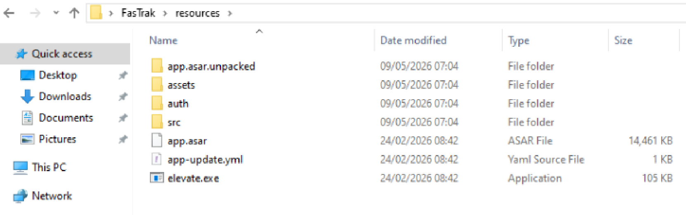
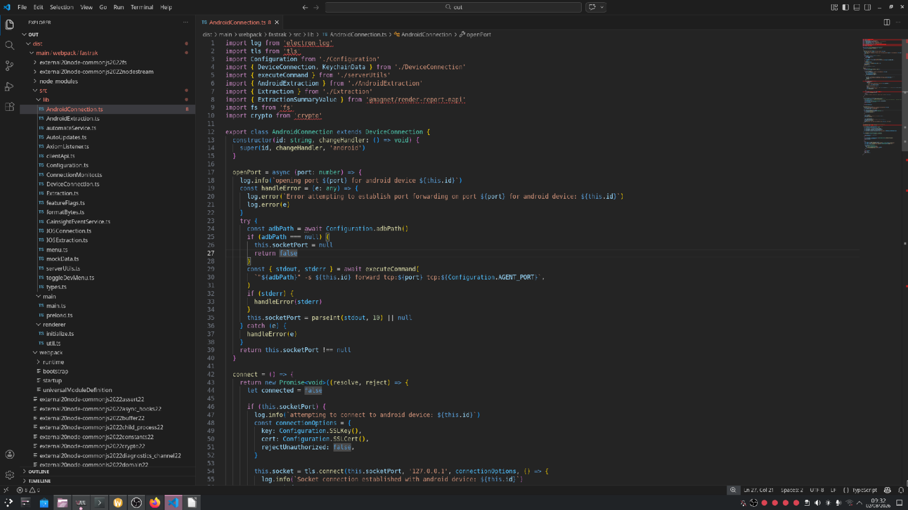
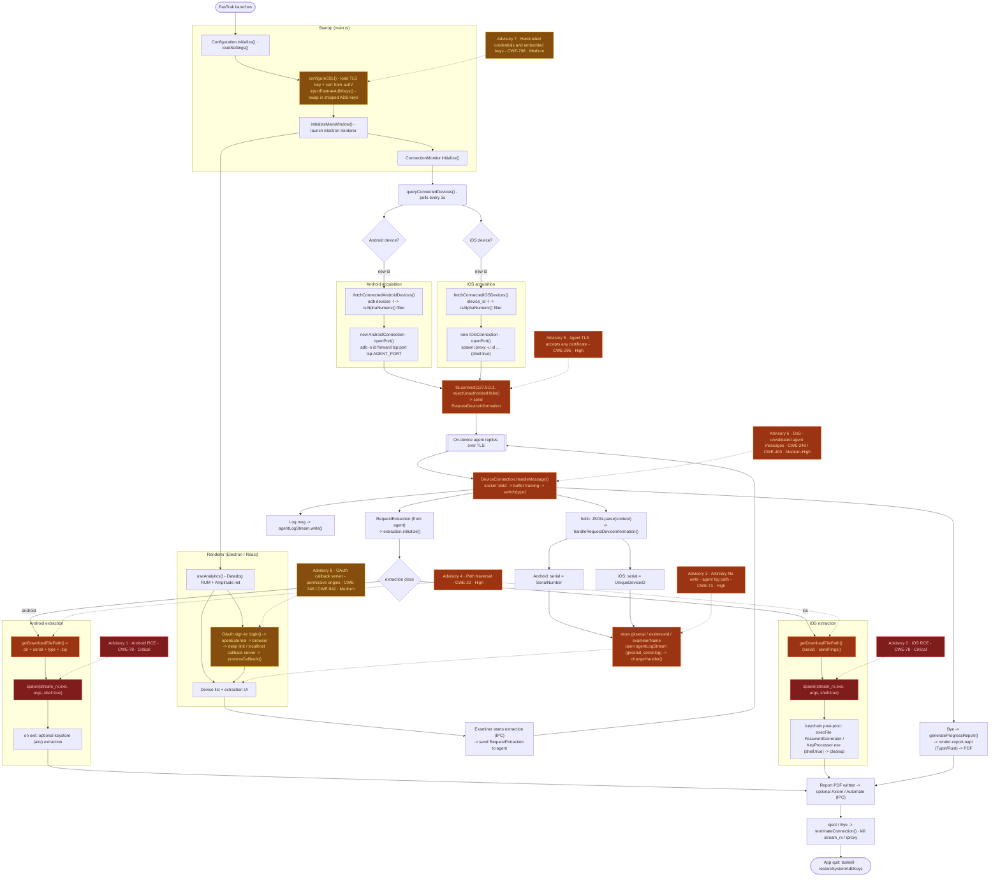
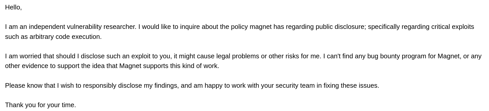
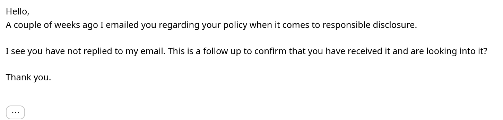
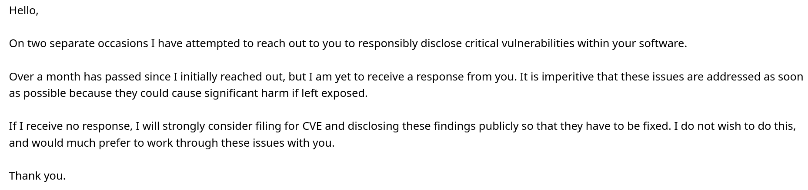
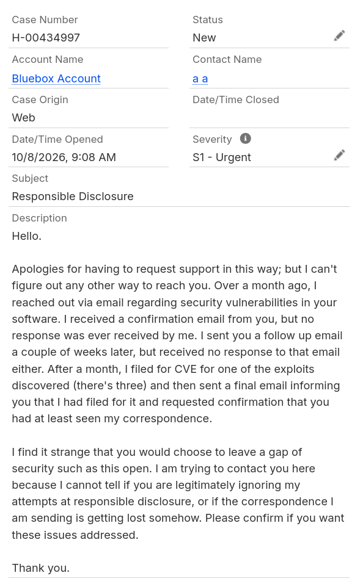
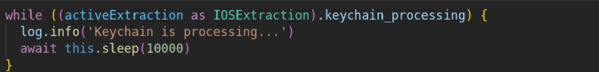

# magnet-exploits

# CVE-2026-106772 (Others pending)

This is a repository documenting my experience discovering and attempting to responsibly disclose a variety of critical issues affecting software created by the digital forensics provider, Magnet Forensics. Magnet's public GitHub account hosts a repository containing a compiled binary for a proprietary software solution they sell, called FasTrak.

The purpose of this software is to provide forensic examiners a tool with which they can extract data from mobile devices that have already been accessed by another tool Magnet provides, GrayKey. From there, the software creates a backup of the full device filesystem, which can then be analysed by a specialised processing tool. I began reverse engineering it to understand how such a tool operates, with no intention of finding any of what is documented later in this report.

This report and accompanying repository assert that the FasTrak software lacks even the most basic security and sanitisation checks. Attackers can freely execute arbitrary system commands with Administrator privileges by simply changing certain device fields. This allows any code they desire to execute when their phone is connected to a computer that has the affected software running and an extraction is started. Because the software is entirely publicly available, it is an ideal target for an attacker. The commands execute silently, meaning a potential examiner would receive no warning that a payload has been executed.

Further, this report documents my attempts to disclose these findings to Magnet Forensics privately before going public, and how they opted not to respond to my attempts to reach out, instead choosing to leave multiple unauthenticated remote code execution vulnerabilities in their software for over three months. This has forced me to release these findings publicly, as I have an ethical obligation to disclose these findings for the safety of the examiners and organisations relying on this software, who deserve to know the risk they are exposed to, and in the hope that public attention will prompt the fixes that private disclosure did not. If a serious threat actor were to discover the same flaws, which I emphasise was not difficult, given their simplicity and low complexity, significant damage could be caused for any organisation using this software.

A tool trusted to preserve evidentiary integrity having unauthenticated RCE or key-exposure issues undermines the chain of custody the whole workflow depends on. Because the exploits contained in this repository allow an attacker to take full control of a forensic workstation, they could change evidence files, tamper with their own evidence and potentially all previous evidence collected by the system. This raises serious implications for the integrity of any device the tool has handled and any legal proceeding that relied on it.

My research was conducted entirely as an outsider using only publicly available information. No prior access was required to achieve the results, and no terms of use or conditions were accepted or broken. There was no unauthorised access to any internal Magnet systems or tools outside of what has been left directly publicly available.

## Findings Index

Eight distinct issues are documented, each in its own directory accompanied by a writeup. Each of these vulnerabilities exploits a different mechanism present within the software.

> *Note: The PoC application used to actually demonstrate the vulnerabilities contained within this repository is currently being withheld. This is to hopefully minimise the amount of damage that could be caused by making these findings public.*

| Severity | Adv. | Finding | Weakness class |
|----------|:----:|---------|----------------|
| **Critical** | 1 | [Android RCE - command injection](rce-android-flow/README.md) | **CWE-78** OS Command Injection |
| **Critical** | 2 | [iOS RCE - command injection](rce-ios-flow/README.md) | **CWE-78** OS Command Injection |
| **High** | 3 | [Arbitrary file write - agent log path](arbitrary-file-write/README.md) | **CWE-73** External Control of File Name or Path |
| **High** | 4 | [Path traversal](path-traversal/README.md) | **CWE-22** Path Traversal |
| **High** | 5 | [Agent TLS accepts any certificate](tls-cert-validation/README.md) | **CWE-295** Improper Certificate Validation |
| **Medium–High** | 6 | [Denial of service - unvalidated agent messages](dos-agent-messages/README.md) | **CWE-248 / CWE-400** DoS (via CWE-20) |
| **Medium** | 7 | [Hardcoded credentials & embedded keys](hardcoded-secrets/README.md) | **CWE-798** Use of Hard-coded Credentials |
| **Medium** | 8 | [OAuth callback server - permissive origins](oauth-callback-server/README.md) | **CWE-346 / CWE-942** Origin Validation |

## Part One: Discovery

FasTrak is publicly downloadable without authentication from Magnet Forensics' own GitHub releases. Simply downloading the file from their releases page yields a full compiled copy of the application, and the installed application itself can be run without any login or licence check.

Following installation, a `/resources/` directory is created inside the FasTrak program folder containing `app.asar`, the packaged application bundle used by Electron/Node.js applications of this kind. Inspecting this archive revealed that it contains JavaScript source-map (`.map`) files alongside the compiled code.

Source maps are used for development-time debugging and are not intended to ship in production builds. Using freely available open-source tooling (in this case, the [reverse-sourcemap](https://github.com/davidkevork/reverse-sourcemap) utility), the entire client-side source code was reconstructed from these maps in its original, unminified form, with no decompilation necessary. The source code even includes comments.

From this point, it was trivial to exploit the vulnerabilities within the software. The code also includes a comment containing the full name of a Magnet Forensics team member. This comment is not reproduced in this report, as even though it is public information, and despite the fact that I have tried to report these issues to the company itself, I do not feel comfortable sharing it in this report.

## Control Flow Chart
Below is a flow chart showcasing the program structure, with all of the vulnerable sections I was able to identify highlighted.

## Disclosure Timeline
As soon as I found all of this, I contacted Magnet directly through their official support email. I didn't attach a report as I hadn't yet compiled my findings into a single document; my plan was simply to show them the vulnerable function code so they could deal with it as quickly as possible. I didn't ask for or expect money, or compensation of any kind.

I sent this email on the 2nd of August 2026. I know it arrived, because I received an automated confirmation saying that a ticket had been created and that they would be in touch soon.

After a couple of weeks of silence, on the 17th of August 2026, I sent a short follow-up, assuming the first email had simply been overlooked.

That went unanswered too. On the 13th of September 2026, I made one final attempt by email. Around the same time, I also filed for a CVE for one of the findings.

That left me considering a simpler explanation: that my emails were being caught by some kind of spam filter. To rule this out, I signed up for an account on their website and raised a ticket from there. I had avoided doing this sooner because registration required my phone number, which could very easily deanonymise me. On the 8th of October 2026 I submitted this ticket.

The ticket describes my final email as telling them that I had already filed for a CVE; that email only warned that I would consider filing one.

I also raised a ticket with CERT/CC through VINCE on the 13th of October 2026. They replied, but could not get into contact with Magnet either, and this public disclosure has been co-ordinated with them.

