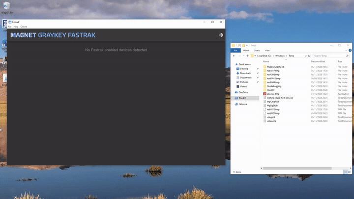

# Advisory 3 - Arbitrary File Write Primitive

| Field | Value |
|---|---|
| **Advisory** | 3 of 8 (see the [findings index](../README.md)) |
| **Weakness** | External Control of File Name or Path (CWE-73), via Improper Input Validation (CWE-20); traversal achieved per CWE-22 |
| **Affected** | Magnet FasTrak 1.17.3 for Windows |
| **Status** | Unpatched at time of publication |

## Description
When a device connects, FasTrak reads a message from the on-device agent via TCP on port 5151 and parses it into an object. FasTrak then uses this message to create a log file for that device as soon as it is connected. An attacker can simply listen for incoming TCP requests on this port and then reply to them with a malicious input to achieve arbitrary file write. They can then leverage FasTrak's own logging functionality to write attacker-controlled text to this file.

## Demonstration



The socket message RequestDeviceInformation:
```ts
switch (message.type) {
  case SocketMessageType.RequestDeviceInformation: {
    log.info(`Received RequestDeviceInformation (aka Hello) message for device ${this.id}`)

    const content = message.content.toString()
    const deviceInfo = JSON.parse(content)

    // Deal with platform-specific data
    this.handleRequestDeviceInformation(deviceInfo)
```
Expects a response like:
```json
{
  "info":{
    "SerialNumber":"",
    "DeviceManufacturer":"",
    "HardwareModel":"",
    "used-bytes":1000
    },
    "v":"1.0.0" ,
    "gkserial": ""
}
```

As stated previously, FasTrak builds a log file created out of unsafe attacker controlled input, specifically the `gkserial` field. The "hello" message is parsed as JSON and its fields are copied directly to the device record (`lib/DeviceConnection.ts:150`):

```ts
this.device.evidenceId = deviceInfo['eid']
this.device.examinerName = deviceInfo['enm']
this.device.gkSerial = deviceInfo['gkserial']
```

Because `gkSerial` is simply whatever string the attacker wants, when it is assembled with `path.join()`, directory traversal characters such as `..\` are normalised. This allows the attacker to place this file wherever they want.

```ts
this.agentLogPath = path.join(
  path.dirname(log.transports.file.getFile().path),
  `${this.device.gkSerial}_${this.device.serial}.log`,
)
this.agentLogStream = fs.createWriteStream(this.agentLogPath, { flags: 'a' })
```

For example, setting `gkSerial` to a value like `..\..\..\..\..\..\Windows\Temp\Exploit` will place a file in the Windows temp directory.

The attacker can then send any number of `Log` messages which then get pushed to the log (`lib/DeviceConnection.ts:265`):

```ts
case SocketMessageType.Log: {
  // Purposely not adding a log for agent log messages, they happen frequently
  const content = message.content.toString()
  this.agentLogStream?.write(format(new Date(), '[yyyy-MM-dd HH:mm:ss.SSS] ') + content + '\n')
  break
}
```
This gives an attacker a primitive that they could use to write attacker-controlled text (each line prefixed with a timestamp) to a chosen path.

## Impact
This exploit allows an attacker to write attacker-controlled text at administrator privilege, without any prior authentication. This is triggered by simply connecting the device, and no other action is required to exploit this vulnerability. The write is create-or-append (`flags: 'a'`) of attacker-controlled content, anywhere the process can write, but with a forced `.log` extension. This would not be as significant as it is if the software itself wasn't a piece of forensic software. An attacker being able to write arbitrary logs could be used to falsify logs, or write to logs outside of their intended scope. Additionally, written data could potentially be used to trigger another exploit in a different piece of software.
