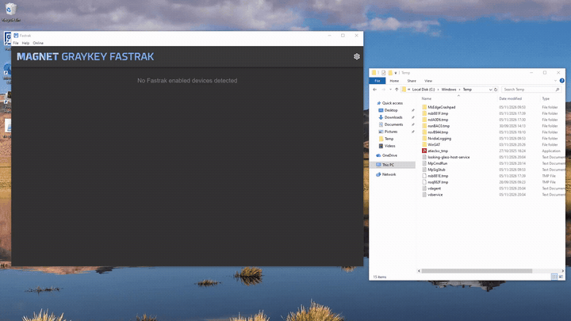

# Advisory 4 - Path Traversal via Unvalidated Device Identifier

| Field | Value |
|---|---|
| **Advisory** | 4 of 8 (see the [findings index](../README.md)) |
| **Weakness** | CWE-22 Path Traversal |
| **Affected** | Magnet FasTrak 1.17.3 for Windows |
| **Status** | Unpatched at time of publication |

## Description

The same `device.serial` used in Advisory 1 is used within the program to build file paths. An attacker can place directory traversal characters in the `device.serial` field to achieve file write. Although this field is the same modified field as in Advisory 1, the mechanism that is exploited is not the same. 

## Demonstration



## Modify the Serial Number field

When a device connects, FasTrak reads a message from the on-device agent via TCP on port 5151 and parses it into an object (`lib/DeviceConnection.ts:139`):

The socket message RequestDeviceInformation:
```ts
switch (message.type) {
  case SocketMessageType.RequestDeviceInformation: {
    log.info(`Received RequestDeviceInformation (aka Hello) message for device ${this.id}`)

    const content = message.content.toString()
    const deviceInfo = JSON.parse(content)

    // Deal with platform-specific data
    this.handleRequestDeviceInformation(deviceInfo)
```
Expects a response like:
```json
{
  "info":{
    "SerialNumber":"",
    "DeviceManufacturer":"",
    "HardwareModel":"",
    "used-bytes":1000
    },
    "v":"1.0.0" ,
    "gkserial": ""
}
```

Next, `handleRequestDeviceInformation` takes fields out of that object and stores them (`lib/AndroidConnection.ts:127`):

```ts
handleRequestDeviceInformation(deviceInfo: any): void {
  const COMPRESSION_ESTIMATE_MULTIPLIER = 0.55

  this.device.serial = deviceInfo.info.SerialNumber
  this.device.make = deviceInfo.info.DeviceManufacturer
  this.device.model = deviceInfo.info.HardwareModel
  this.device.extractionSize = deviceInfo.info['used-bytes'] * COMPRESSION_ESTIMATE_MULTIPLIER
}
```

Multiple output paths are created using the value stored in `device.serial`.

```ts
getDownloadDirectory = () => {
  const extractionTypeLabel =
    this.details.selectedCategoriesCount > 0 || this.details.includeKeychain ? 'category' : 'full'
  const extractionDir = `${this.details.downloadPath}\\${this.connection.device.id}_${this.details.timeStamp}_${extractionTypeLabel}`
  if (!fs.existsSync(extractionDir)) {
    fs.mkdirSync(extractionDir)
  }
  return extractionDir
}

getDownloadFilePath = () =>
  `${this.getDownloadDirectory()}\\${this.connection.device.serial}_${this.extractionType}.zip`

writeHashesToFile = () => {
  const hashFilePath = `${this.getDownloadDirectory()}\\${this.connection.device.serial}_${
    this.extractionType
  }_hashes.txt`
  fs.writeFileSync(hashFilePath, `MD5: ${this.details.md5Hash}\nSHA256: ${this.details.sha256Hash}`)
}
```

The keystore path is created this way too:

```ts
getKeystoreFilePath = () => `${this.getDownloadDirectory()}\\${this.connection.device.serial}_aks.zip`
```

So, setting `SerialNumber` to a value like `..\..\..\..\..\..\Windows\Temp\Exploit` allows an attacker to place a text file in the Windows temp directory.

## Impact
This exploit allows an attacker to redirect output and related files to their own desired locations. They can also overwrite unrelated files. This could be used to further reinforce and hide the RCE chain.
