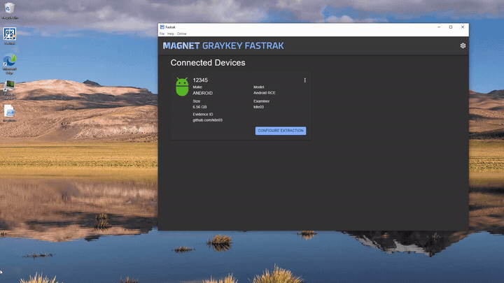

# Advisory 1 - Unauthenticated Remote Code Execution Techniques using modified Device Fields (Android)

| Field | Value |
|---|---|
| **Advisory** | 1 of 8 (see the [findings index](../README.md)) |
| **Weakness** | CWE-78 OS command injection, via CWE-20 improper input validation |
| **Affected** | Magnet FasTrak 1.17.3 for Windows, Android acquisition path |
| **Status** | Unpatched at time of publication |

## Description

An attacker-controlled device can register a TCP listener service on port 5151 that responds to FasTrak's Hello message with a crafted payload to achieve code execution. This is trivial because the information required to emulate this handshake is contained within the public binary. The information contained within the agent's messages is never validated or sanitised, and is directly interpolated through by the application into a shell when an extraction of the poisoned device is initiated. Simply running a service that occupies this port is enough to prevent the software from working.

## Demonstration



There are two known attacker-controlled values that can be leveraged to achieve code execution, the supplied serial number and the extraction type. In the demonstration, the "extraction type" is the modified field. Note that although the `SerialNumber` is visible in the GUI, meaning a payload can be spotted by an examiner before it can execute, the `extractionType` field is not. This means that the examiner receives no indication that exploitation has occurred. Because the program runs as Administrator, the attacker's shell also has Administrator privileges, widening the scope of damage that a payload deployed in this manner could cause.

## Field 1 - Modify the Serial Number field

When a device connects, FasTrak reads a message from the on-device agent via TCP on port 5151 and parses it into an object (`lib/DeviceConnection.ts:139`):

The socket message RequestDeviceInformation:
```ts
switch (message.type) {
  case SocketMessageType.RequestDeviceInformation: {
    log.info(`Received RequestDeviceInformation (aka Hello) message for device ${this.id}`)

    const content = message.content.toString()
    const deviceInfo = JSON.parse(content)

    // Deal with platform-specific data
    this.handleRequestDeviceInformation(deviceInfo)
```
Expects a response like:
```json
{
  "info":{
    "SerialNumber":"",
    "DeviceManufacturer":"",
    "HardwareModel":"",
    "used-bytes":1000
    },
    "v":"1.0.0" ,
    "gkserial": ""
}
```

Note that any value, including `SerialNumber`, is a value that an attacker controls. It would be possible for them to tamper with evidence here, as they could send falsified extraction data, or they could report false device identifiers. This alone is enough to raise concerns about the integrity of the data collected.

Next, `handleRequestDeviceInformation` takes fields out of that object and stores them (`lib/AndroidConnection.ts:127`):

```ts
handleRequestDeviceInformation(deviceInfo: any): void {
  const COMPRESSION_ESTIMATE_MULTIPLIER = 0.55

  this.device.serial = deviceInfo.info.SerialNumber
  this.device.make = deviceInfo.info.DeviceManufacturer
  this.device.model = deviceInfo.info.HardwareModel
  this.device.extractionSize = deviceInfo.info['used-bytes'] * COMPRESSION_ESTIMATE_MULTIPLIER
}
```

`this.device.serial = deviceInfo.info.SerialNumber` assigns whatever string the attacker set with no validation from the `SerialNumber` field in the earlier step. 

`device.serial` is then interpolated into a file path at (`lib/Extraction.ts:59`). This function is then called by the `initialize()` function when an extraction starts:

```ts
getDownloadFilePath = () =>
  `${this.getDownloadDirectory()}\\${this.connection.device.serial}_${this.extractionType}.zip`
```

## Field 2 - Modify the Extraction Type

When an extraction is initialised, a `RequestExtraction` message is sent from the client to the device agent, which replies with its own `RequestExtraction` message.

The socket message RequestExtraction: 
```ts
case SocketMessageType.RequestExtraction: {
  const content = message.content.toString()
  const extractionData = JSON.parse(content)

  if (!extractionData.type || !extractionData.streamPort) {
    log.warn('Agent requested extraction without specifying type or stream port')
    break
  }

  const streamPort = parseInt(extractionData.streamPort, 10)
  const extractionType = extractionData.type
  const extraction = this.getActiveExtraction()
  if (extraction) {
    extraction.initialize(streamPort, extractionType)
  } else {
    log.error('Extraction should already be active')
  }
}
```
Expects a response like:
```json
{
  "type": "",
  "streamPort": ""
}
```

The `initialize()` function then calls `getDownloadFilePath()`, causing the poisoned value to be included in the getDownloadFilePath string (`lib/Extraction.ts:59`):

```ts
getDownloadFilePath = () =>
  `${this.getDownloadDirectory()}\\${this.connection.device.serial}_${this.extractionType}.zip`

```

## Achieving Code Execution

After the `initialize()` function is called the following code runs. The poisoned values are returned when `getDownloadFilePath()` is called.

```ts
const streamRXpath = `"${Configuration.streamRxPath()}\\stream_rx.exe"`
const filePath = this.getDownloadFilePath()
log.info(`[Android][${extractionType}] getDownloadFilePath() returned: ${filePath}`)
let streamRxFilePath = filePath
```

The attacker controlled `extractionType` or `device.serial` string is now unsanitised in the middle of the path string. When extraction starts, FasTrak passes that path to a child process (`lib/AndroidExtraction.ts:36`):

```ts
const filePath = this.getDownloadFilePath()
...
let streamRxFilePath = filePath
...
this.rxStreamProcess = spawn(
  streamRXpath,
  [
    '1',
    `${this.connection.device.id}`,
    `${this.streamPort}`,
    `"${streamRxFilePath}"`, // <- the tainted path is now used as an argument
    `--adb-path "${Configuration.adbPath()}"`,
  ],
  {
    env: { ...process.env, ADB_PATH: Configuration.adbPath() || '' },
    shell: true,
  },
)
```

With `shell: true`, Node builds a single command line and passes it directly to `cmd.exe` so values passed this way are treated as commands. Node's `child_process` documentation advises against using `shell: true` with unsanitised input for this exact reason. This allows an attacker to execute any arbitrary system command they want on the machine.

---

## Impact

The injected commands run with full Administrator privilege, allowing an attacker to essentially fully compromise a host machine. This vulnerability is especially dangerous because it targets forensic acquisition software, meaning that an attacker could use this technique to tamper with evidence from both their own case and as well as any other case stored on the workstation. Because the commands run silently, the examiner receives no indication that exploitation has occurred.

## Remediation

The simplest fix is to stop invoking the extraction helpers through a shell. Simply calling the `spawn` function with `shell:false` and passing the arguments as an array (without the hand-added quotes) is enough to remedy this issue. Basic sanitisation should also always be implemented on any field that can be controlled by an attacker.
