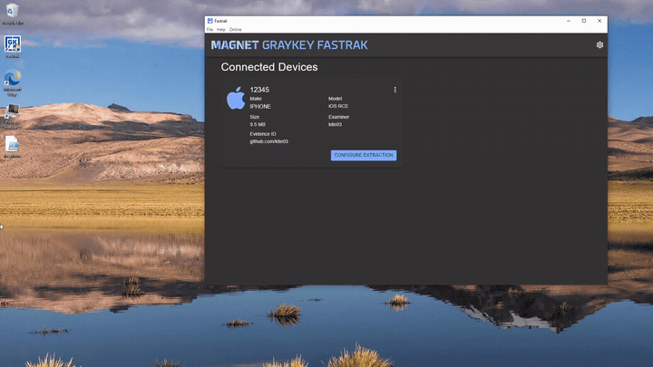

# Advisory 2 - Unauthenticated Remote Code Execution via Unvalidated Device Fields (iOS)

| Field | Value |
|---|---|
| **Advisory** | 2 of 8 (see the [findings index](../README.md)) |
| **Weakness** | CWE-78 OS command injection, via CWE-20 improper input validation |
| **Affected** | Magnet FasTrak 1.17.3 for Windows, iOS acquisition path |
| **Status** | Unpatched at time of publication |

## Description

Even though this method for achieving code execution exploits a different section of code within the FasTrak software, it still falls under the same attack class (command injection) as the first Advisory. Just like before, the connection handler copies device-supplied fields out of the attacker's messages with no validation, and those fields reach a similar `shell: true` child-process spawn, leading to code execution.

## Demonstration



## Field 1 - Modify the ExtractionType field

The `type` field can again be modified exactly the same way as in Advisory 1. This is the field modified in the demonstration.

## Field 2 - Modify the UniqueDeviceID field

The iOS handler takes a different field name - `UniqueDeviceID` - but treats it just as carelessly as the Android handler treats `SerialNumber` (`lib/IOSConnection.ts:166`):

```ts
handleRequestDeviceInformation(deviceInfo: any): void {
  this.device.serial = deviceInfo.info.UniqueDeviceID
  this.device.make = deviceInfo.info.DeviceClass
  this.device.model = deviceInfo.info.ProductType
  this.device.extractionSize = deviceInfo['used-bytes']
}
```

`this.device.serial` is set straight from the device's claimed `UniqueDeviceID`, with no validation. It is then passed to the same `getDownloadFilePath()` (`lib/Extraction.ts:59`) as before, and that path is then handed to a similar (but not identical) child process spawned through the shell (`lib/IOSExtraction.ts:64`).

Note that a payload in this field must contain a `"` to escape the quoted path. On iOS the serial is also used as the extraction folder name, which is created with `mkdirSync` before the spawn (`lib/IOSExtraction.ts:24`), and Windows does not allow `"` in folder names, so this route is blocked before the spawn is reached.


## Achieving Code Execution

The `"${streamRxFilePath}"` argument again carries the payload, with the same `shell:true` as before. The difference is that this code is in a different class (`IOSExtraction` instead of `AndroidExtraction`), making the exploited mechanism technically different. Also, the first argument is `0` instead of `1`.

```ts
initialize = (streamPort: number, extractionType: string) => {
  ...
  this.streamPort = streamPort
  this.extractionType = extractionType
  let monitor: NodeJS.Timeout | undefined
  const streamRXpath = `"${Configuration.streamRxPath()}\\stream_rx.exe"`
  const filePath = this.getDownloadFilePath()
  let streamRxFilePath = filePath
  this.connection.device.activeExtraction = true
  ...

  this.rxStreamProcess = spawn(
    streamRXpath,
    ['0', `${this.connection.device.id}`, `${this.streamPort}`, `"${streamRxFilePath}"`],
    {
      env: {
        ...process.env,
        IPROXY_PATH: `${Configuration.libimobiledevicePath()}\\iproxy.exe`,
      },
      shell: true,
    },
  )
  this.stream_rx_running = true
  ...
}
```


This `stream_rx` spawn above is not the only place where this issue occurs. Unlike Android, iOS builds the extraction folder from `device.serial` (`lib/IOSExtraction.ts:24`):

```ts
getDownloadDirectory = () => {
  const extractionTypeLabel =
    this.details.selectedCategoriesCount > 0 || this.details.includeKeychain ? 'category' : 'full'
  const extractionDir =
    `${this.details.downloadPath}\\${this.connection.device.serial}_${this.details.timeStamp}_${extractionTypeLabel}`
  if (!fs.existsSync(extractionDir)) {
    fs.mkdirSync(extractionDir)
  }
  return extractionDir
}
```

The keychain output paths are then built from the same `extractionDir` and `device.serial` (`lib/IOSExtraction.ts:304` and `:38`).

```ts
const passwordOutputFilePath = `${extractionDir}\\${this.connection.device.serial}_passwords.txt`
// plistOutputFilePath, via getKeychainFilePath():
//   `${this.getDownloadDirectory()}\\${this.connection.device.serial}_keychain.plist`
```

During keychain post-processing those paths are passed to two further child processes, which are both also spawned with `shell: true`:

```ts
// new-format keychain (lib/IOSExtraction.ts:312)
await execFilePromise(
  `"${Configuration.passwordGeneratorPath()}\\StandalonePasswordGenerator.exe"`,
  [`"${extractionDir}"`, `"${plistOutputFilePath}"`, `"${passwordOutputFilePath}"`],
  { shell: true, timeout: 600000 },
)

// old-format keychain (lib/IOSExtraction.ts:374)
await execFilePromise(
  `"${Configuration.keychainProcessorPath()}\\StandaloneKeyProcessor.exe"`,
  [`"${extractionDir}"`, `"${keychainDbFilePath}"`, `"${bplistFilePath}"`, `"${plistOutputFilePath}"`, `"${passwordOutputFilePath}"`],
  { shell: true, timeout: 600000 },
)
```

This means that there are multiple `shell: true` sinks in this code, although because the keychain paths are built from `device.serial`, they share the folder-name limitation described in Field 2.

---

## Impact

The injected commands run with full Administrator privilege, allowing an attacker to essentially fully compromise a host machine. This vulnerability is especially dangerous because it targets forensic acquisition software, meaning that an attacker could use this technique to tamper with evidence from both their own case and as well as any other case stored on the workstation. Because the commands run silently, the examiner receives no indication that exploitation has occurred.

## Remediation
Every `spawn` and `execFile` call MUST use shell:false, and passing the arguments as an array (without the hand-added quotes) is enough to remedy this issue. Basic sanitisation should also always be implemented on any field that can be controlled by an attacker.
